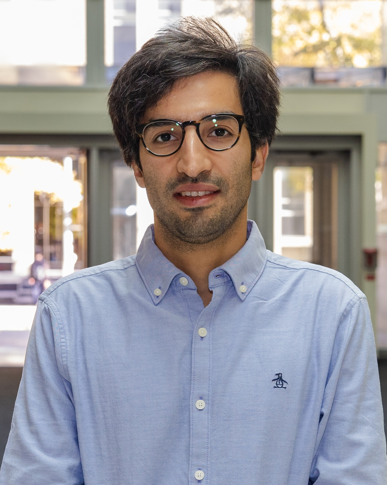

---
---
:::: {.columns}

::: {.column width="25%"}
{width=200px}

::: {.photo-caption}
Photo by [Aaron Demeter](https://www.aarondemeter.com/)\
Bahen, Fall 2026
:::

[Discover Research](https://discover.research.utoronto.ca/48690-ali-bereyhi){.btn .btn-outline-primary .btn-sm target="_blank"}

[U Toronto Page](https://www.ece.utoronto.ca/people/bereyhi-a/){.btn .btn-outline-primary .btn-sm target="_blank"}

[Google Scholar](https://scholar.google.com/citations?user=_lhGcFwAAAAJ&hl=en){.btn .btn-outline-primary .btn-sm target="_blank"}

[LinkedIn](https://ca.linkedin.com/in/alibereyhi){.btn .btn-outline-primary .btn-sm target="_blank"}

:::
::: {.column width="75%"}
### Ali Bereyhi
ECE Department\
University of Toronto\
Faculty Affiliate at SRI\

BA7208 | [Bahen Centre for Information Technology](https://en.wikipedia.org/wiki/Bahen_Centre_for_Information_Technology)\
Email: [`ali[dot]bereyhi[at]utoronto[dot]ca`](mailto:ali.bereyhi@utoronto.ca)

## About

I am Assistant Professor (TS) in the Department of Electrical and Computer Engineering at the University of Toronto. I am also Faculty Affiliate at [Schwartz Reisman Institute (SRI)](https://srinstitute.utoronto.ca/). My main area of focus is Machine Learning (ML) and Information Theory. My teachings cover a wide scope of topics in theory and applications of machine learning learning, ranging from _Deep Learning_ and _Statistical Methods_ to _Reinforcement Learning_ and _Generative Models._ My research focuses on fundamental limits of ML models and their applications to Statistical Signal Processing. 

I received my PhD (in German _Doktor der Ingenieurwissenschaft_) with distinction from Friedrich Alexander Universität (FAU) in Germany, supervised by [Prof. Dr.-Ing. Ralf R. Müller](https://www.idc.tf.fau.eu/faudir/prof-dr-ing-ralf-muller/) and [Prof. Dr. Hermann Schulz-Baldes](https://www.math.fau.de/mathematische-physik/hermann-schulz-baldes/). My doctoral dissertation, entitled [Statistical Mechanics of Regularized Least Squares](https://open.fau.de/items/55d6b9b4-0e03-485d-b8a5-21ffe03a48f7), investigates the connections between Theoretical Physics and the Theory of Learning. You can also find me on the Mathematics Genealogy Project!

## Openings in My Group
Perspective graduate students are welcome to contact me by email. You can take a look at the [current research](research.qmd) in my team.

### MEng Research Projects 

Those who are interested in graduate research projects either in the form of _Research Internship_ or _MEng Research Module, e.g., ECE2500,_ may reach out through email. 

- There are currently open projects on _Quantum Machine Learning_ and _AI Safety_
- [New:]{style="color: red;"} I am looking for motivated Master's students to join a research on _Safety Risks Associated with Malicious Coordination among AI Agents._ The position is full-time, starting _as soon as possible_ and ending on _March 2027._ The project can be undertaken as part of the _MEng Research Module._ If interested, please send me a brief introduction and your CV by email.

### Disclaimer 

Unfortunately, I am not able to respond to all application emails. If you don't hear back from me in a course of one week or so, it is safe to consider the case closed. In that case, please accept my sincere apology for not being responsive to your email. I wish you all success with your application and thank you for taking time to write to me.

## News

<a href="/news-archive.html">News Archive</a>

:::

::::

 

